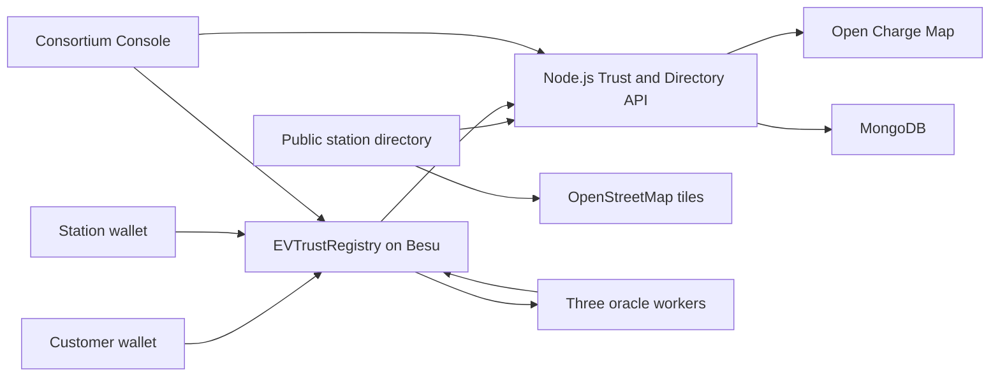

# Blockchain-Based EV Charging Authentication with Dynamic Trust Management

This project registers electric vehicles and charging stations on a private ledger. Both parties sign a challenge, the smart contract checks their trust scores, and an authorized customer can fund a charging budget. The station and customer sign the same meter reading before the contract allocates payment and any unused balance. Oracle workers use the finalized outcome to update both participants’ reputations.

The public directory displays listings from Open Charge Map. The private Besu workspace runs the project’s charging protocol with local test ETH and software meter readings. Public directory listings are independent of the station identities enrolled on Besu.

## Web pages

| Page | Purpose |
|---|---|
| [Public station directory](http://127.0.0.1:5173/) | Find chargers on an interactive map, search by station, operator or address, and view connector details and directions |
| [Customer](http://127.0.0.1:5173/?mode=course#customer) | Choose an enrolled station, sign an EV challenge, fund an authorized session, review the meter reading, and withdraw the refund |
| [Station Owner](http://127.0.0.1:5173/?mode=course#station) | Verify and countersign challenges, record metered energy, submit settlement, and withdraw the station payment |
| [Charging and settlement](http://127.0.0.1:5173/?mode=course) | Use both roles in one view by switching wallets |
| [Consortium Console](http://127.0.0.1:5173/?mode=course#consortium) | Register identities, rotate or revoke signing keys, manage trust policy, and inspect proposals and ledger activity |

## Getting started

### Requirements

- Node.js 22 or 24 LTS and npm. Use PowerShell for the commands below, or a Linux terminal.
- WSL on Windows, or Linux directly, with Hyperledger Besu and its required Java runtime. This workspace was verified with Besu 26.11.1 and Java 25.
- MongoDB Community Server in WSL or Linux, or an existing MongoDB instance with a configured connection URI.
- MetaMask or another compatible browser wallet for signing private-chain operations.
- An Open Charge Map API key for the public directory. Python with NumPy and Matplotlib is required only for regenerating figures.

The Besu launcher uses the default WSL distribution on Windows. It checks for Besu at `~/.local/share/ev-trust-tools/besu-26.11.1/bin/besu` and Java at `~/.local/share/ev-trust-tools/jdk`. You can also put `besu` on the Linux shell’s PATH or set `BESU_EXECUTABLE` there. The MongoDB launcher accepts `mongod` on PATH or `MONGOD_EXECUTABLE`. [MongoDB Community installation](https://www.mongodb.com/docs/v8.0/tutorial/install-mongodb-on-ubuntu/)

### Install dependencies and configure the API

From the project root, install the three Node.js packages.

```powershell
npm ci
npm --prefix trust-engine ci
npm --prefix frontend ci
```

Create `trust-engine/.env` and replace the API-key placeholder with your own key. Leave the MongoDB defaults for the local setup.

```dotenv
OPEN_CHARGE_MAP_API_KEY=replace_with_your_key
MONGODB_URI=mongodb://127.0.0.1:27017
MONGODB_DB=ev_charging
```

The backend sends the Open Charge Map key in a server-side request header. Keep the key in `trust-engine/.env`. The file is git-ignored. Vite proxies browser requests under `/api/trust-engine` to the API on port 3001.

### Start the ledger and the app

Start MongoDB and the four Besu validators.

```powershell
npm run mongo:up
npm run besu:up
```

On the first run, deploy the registry and provision the station choices.

```powershell
npm run besu:deploy
npm run besu:stations
```

The deploy command writes the contract address, chain ID, deployment block, and RPC URL to `frontend/src/deployedAddress.json`. Provisioning adds local station identities `did:station:001` through `did:station:018`. Each station has its own signing account.

Run the following in three separate terminals from the project root.

| Terminal | Command |
|---|---|
| Oracle workers | `npm run besu:oracles` |
| Trust and directory API | `npm --prefix trust-engine start` |
| Frontend | `npm --prefix frontend run dev` |

Open the relevant webpage from the table above. The frontend listens on port 5173. Stop the three terminal processes with Ctrl+C and use `npm run besu:down` to stop the validators. A normal restart reuses the existing registry and data. Deploy again only when you want a new registry, then restart the API and oracle workers so they pick up its address.

### Set up MetaMask

| Network field | Value |
|---|---|
| Network name | EV Charging Besu IBFT |
| RPC URL | `http://127.0.0.1:8547` |
| Chain ID | `43210` |
| Currency symbol | `ETH` |
| Block explorer | Leave blank |

Use the wallet registered for the role you are performing. For the default local identities, `.local-chain/accounts.json` contains the `ev` key for `did:ev:001` and the `station` key for `did:station:001`. The other station keys are in `.local-chain/station-accounts.json`, indexed by DID. If you import a local test account, choose **Private Key** in MetaMask and copy just that account’s value into the wallet. Keep both files private and use their keys only on the local Besu chain.

## Charging workflow on Besu

1. **Customer signs the challenge.** Open the Customer page with the registered EV wallet. Select a **Station DID** and click **Sign as EV**. Copy the signed challenge to the station owner.
2. **Station owner authorizes the session.** Select the wallet registered to that station. Paste the challenge, then click **Countersign and authorize as station**. Besu checks both signatures, both registrations, revocation, and the minimum trust score. The station owner shares the **Authorized session ID** returned by the contract.
3. **Customer funds the budget.** Switch back to the EV wallet. Paste the Session ID and click **Load session**, or click **Find my latest session**. Enter the maximum energy in Wh and the price in test ETH per Wh. Click **Fund as EV**. The UI sets a one-hour funding window.
4. **Station owner signs the meter reading.** Load the same funded session, enter the delivered energy in Wh, and click **Sign meter reading**. Copy the signed meter packet to the customer.
5. **Customer countersigns the reading.** Paste the meter packet, confirm the displayed energy, and click **Sign meter reading**. Return the packet containing both signatures to the station owner.
6. **Station owner settles the session.** Paste the returned packet and click **Settle payment**. The station can withdraw the earned amount, and the EV can withdraw the unused budget. If the budget expires before settlement, the EV can recover the deposit through the refund flow.

When you switch roles in the same browser tab, the session fields and signed packets carry across the Customer and Station Owner pages. In separate tabs or browser profiles, use the copy buttons to transfer the challenge, Session ID, and meter packet. The same Session ID identifies the session for both parties.

## How the components work



| Component | Responsibility |
|---|---|
| React, Vite, Leaflet | Renders the public map and the wallet-based Customer, Station Owner, and Consortium pages |
| Solidity and OpenZeppelin | Verifies signatures, applies the trust threshold, enforces roles, and manages prepaid balances |
| Hyperledger Besu and IBFT 2.0 | Runs four validator nodes locally and confirms ledger transactions |
| Node.js, Express, and ethers.js | Serves the directory and records API, indexes confirmed registry events, and supports the Hardhat development endpoints |
| Oracle workers | Independently replay settled sessions and propose or approve matching trust updates |
| MongoDB | Stores directory snapshots, indexed identities, session records, proposals, and event history |

### Identity, signatures, and settlement

A registrar enrolls each entity using a DID hash and a signing address. A registrar can rotate that address or revoke the identity. On-chain registration records contain hashes rather than resolvable DID documents.

The authorization challenge includes the EV and station DID hashes, a random 32-byte nonce, the contract address, and the chain ID. The registered wallets sign the digest. The contract consumes the nonce once both signatures are valid, then checks both trust scores. The default threshold is 3,000 out of 10,000. A valid challenge below that threshold produces an on-chain denial.

The deposit equals `maxWh × pricePerWh`. The meter signatures bind the session ID, delivered Wh, funded energy ceiling, price, expiry, chain ID, and contract address. Settlement requires both signatures over the same values and rejects readings above the funded limit. The contract credits the station for the delivered energy and credits the EV with the remaining deposit. Both parties can then withdraw their credit.

### Dynamic trust and independent oracles

Every new entity starts at a trust score of 0.50. Each course oracle independently reads confirmed settlement events in ledger order and uses their timestamps to decay evidence. A positive settled energy amount counts as a success. A jointly settled zero reading counts as a failure. The contract uses the last quorum-approved score during authorization.

```text
decay      = exp(-0.01 × elapsed_hours)
alpha_new  = 1 + (alpha_old - 1) × decay + (1 if successful else 0)
beta_new   = 1 + (beta_old  - 1) × decay + (0 if successful else 1)
trust      = alpha_new / (alpha_new + beta_new)
score_e4   = round(trust × 10000)
```

The `alpha` and `beta` values begin at 1. Over time, evidence above that baseline carries less weight. The default policy requires two of the three oracle accounts to agree on a score. Each settlement can apply one accepted score proposal per participant. A separate quorum-approved slash can lower a trust score directly.

### MongoDB and the public directory

MongoDB is the application’s store for historical browsing and API queries. Besu is authoritative for signed authorization, reputation commitments, and payment. The indexer reads events from the deployment block and resumes from a MongoDB checkpoint. The API imports missing records from the old `trust-engine/reputation-store.json` at startup. Browser drafts and private keys stay on the client or in local key files.

| Collection | Records |
|---|---|
| `registry_entities` | EV and station signing addresses, revocation status, and trust profiles |
| `charging_sessions` | Session authorization, funding terms, meter totals, settlement and refund state |
| `oracle_proposals` | Proposal details, approval counts, and execution state |
| `ledger_events` | Registry event names, block numbers, arguments, and transaction hashes |
| `ledger_checkpoints` | Last indexed block for the deployment |
| `reputation` | Reputation and outcome records used by the development trust API |
| `public_station_directory` | Cached Open Charge Map responses by country |

The public directory defaults to India (`IN`) and loads up to 200 Open Charge Map listings per country. Search filters the loaded stations. Selecting a marker or a station card opens connector types, power, and any reported price. Results are cached for ten minutes, and data provider attribution is shown in station details. Reported operational status can differ from current connector availability. Public stations continue to use their operators’ authorization and billing. [Open Charge Map API](https://www.openchargemap.org/develop/api) · [Map attribution](https://www.openstreetmap.org/copyright)

### API routes

The API listens at `http://127.0.0.1:3001`. Browser requests use the Vite proxy.

| Route | Use |
|---|---|
| `GET /health` | Check the registry and MongoDB connection |
| `GET /directory/stations?country=IN` | Load public charging station records by country |
| `GET /records/sessions` | List indexed sessions with optional `evId`, `stationId`, or `sessionId` filters |
| `GET /records/entities` | List indexed EV and station identities |
| `GET /records/proposals` | List indexed oracle proposals |
| `GET /records/events` | List indexed ledger events |
| `GET /entities/:didHash` | Read an entity directly from the registry |

The record-list routes accept `limit` from 1 to 100. Hardhat development mode also provides endpoints for entity registration, test funding, station countersigning, session relaying, outcome reporting, and misbehavior proposals. On the Besu workspace, participants and oracles send signed transactions directly to the contract.

## Tests and measured results

```powershell
npm test
npm --prefix trust-engine test
npm --prefix frontend run build
```

The contract tests cover identity checks, replay protection, denial by trust threshold, quorum behavior, payment, refunds, and revocation. The trust-engine tests cover the neutral prior, elapsed-time decay, failed outcomes, and concurrent reputation updates. Hardhat is also available as a separate simulator. Run `npm run node` and `npm run deploy:local` when intentionally switching to that simulator. Those commands use chain ID `31337` and update the frontend deployment file.

With Besu and its oracles running, `npm run besu:verify` submits a charging session and checks authorization, settlement, withdrawals, and quorum approval. It writes transaction hashes, receipt gas usage, and timing data to `.local-chain/benchmark.json`. Run `python generate_figures.py --benchmarks-only` to regenerate the measured figures.

A local four-validator run settled a 380 Wh session and moved both trust scores from 5,000 to 6,667. The run recorded the following values.

| Operation | Gas used | Submission to confirmation |
|---|---:|---:|
| Mutual authentication | 159,962 | 1.713 s |
| Fund the budget | 112,133 | 4.077 s |
| Settle the meter reading | 122,462 | 3.783 s |
| Withdraw the station payment | 28,597 | 3.952 s |
| Withdraw the EV refund | 28,597 | 3.961 s |

The same run confirmed 12 authorization transactions in 4.863 seconds, about 2.47 transactions per second for that batch. These are local measurements for one workload. [Latency figure](paper_figures/fig5_latency_comparison.png) · [Gas and throughput figure](paper_figures/fig6_gas_and_throughput.png)

## Project layout

| Path | Main responsibility |
|---|---|
| `contracts/EVTrustRegistry.sol` | Identity, authentication, trust governance, and settlement |
| `scripts/` | Besu lifecycle, deployment, station provisioning, MongoDB startup, and verification |
| `frontend/src/components/` | Public station map and private role-based pages |
| `trust-engine/oracleWorker.js` | Replays settled sessions and submits independent approvals |
| `trust-engine/openChargeMap.js` | Server-side Open Charge Map calls and cache |
| `trust-engine/ledgerRecords.js` and `mongoStore.js` | Ledger indexing and application storage |
| `test/` and `trust-engine/trustEngine.test.js` | Smart contract and reputation tests |
| `paper_figures/` | Architecture, trust model plots, and measured performance figures |

## Team contributions

The following is a proposed allocation of technical responsibilities. Confirm the assignments with the team before using them as individual contribution claims.

| Team member | Technical area | Contributions |
|---|---|---|
| Siddhant Udavant | System integration and Besu network | Four-validator IBFT network, deployment workflow, local station provisioning, and integration between the registry and the application |
| Arjun Sonkusare | Smart contract and settlement | DID registry, authorization policy, quorum logic, prepaid budget, dual-signed metering, refunds, and contract tests |
| Rishi Shetty | Trust engine and MongoDB | Beta-reputation computation, elapsed-time decay, independent oracle processing, MongoDB migration, and ledger indexing |
| Vishal Todakar | Wallet authentication and private portals | MetaMask connection, wallet-to-DID matching, Customer and Station Owner workflows, and signed packet handoff |
| Aditya Shinde | Public station directory and performance testing | Open Charge Map API integration, station search and interactive map, end-to-end verification, and gas and latency measurement |
