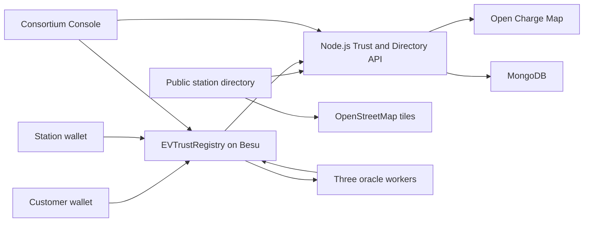

# Blockchain-Based EV Charging Authentication with Dynamic Trust Management

This project registers electric vehicles and charging stations on a private ledger. Both parties sign a challenge, the smart contract checks their trust scores, and an authorized customer can fund a charging budget. The station and customer sign the same meter reading before the contract allocates payment and any unused balance. Oracle workers use the finalized outcome to update both participants’ reputations.

The public directory displays listings from Open Charge Map. The private Besu workspace runs the project’s charging protocol with local test ETH and software meter readings. Public directory listings are independent of the station identities enrolled on Besu.

## Project goals and scope

A charging session has three decisions to record. The EV and station must prove that they control the keys enrolled for their identities, both must meet the consortium’s current trust threshold, and both must agree on the delivered energy before payment is allocated. The project implements that sequence with a Solidity registry, browser wallets, and a prepaid budget denominated in test ETH. Each settled session becomes evidence for the next trust decision.

| Goal | How the project demonstrates it |
|---|---|
| Mutual authentication | The EV and station sign the same single-use challenge. The registry checks both wallet addresses and records the authorization result. |
| Behavior-based access | Both identities start with a neutral score. Oracles recompute their reputations from settled outcomes and require a quorum before updating the ledger. |
| Meter-based settlement | The contract holds the budget until it receives matching signatures over the energy delivered, then credits both wallets according to the agreed price and energy. |
| Auditable operations | Registry events record registrations, denials, payment transitions, and trust proposals. The API indexes those events for the consortium console. |

The private workspace is a course prototype. The station owner enters the meter reading in the browser and the EV confirms it there. The signatures establish which wallets agreed to the reading. Hardware metering, charger control, and real-world billing are outside the prototype’s scope.

## Contents

- [Web pages](#web-pages)
- [Getting started](#getting-started)
- [Charging workflow on Besu](#charging-workflow-on-besu)
- [Architecture, contracts, trust model, and API](#how-the-components-work)
- [Tests and measured results](#tests-and-measured-results)
- [Troubleshooting](#troubleshooting)
- [Project layout](#project-layout)
- [Team contributions](#team-contributions)
- [Contributing changes](#contributing-changes)

## Web pages

| Page | Purpose |
|---|---|
| [Public station directory](http://127.0.0.1:5173/) | Find chargers on an interactive map, search by station, operator or address, and view connector details and directions |
| [Customer](http://127.0.0.1:5173/?mode=course#customer) | Choose an enrolled station, sign an EV challenge, fund an authorized session, review the meter reading, and withdraw the refund |
| [Station Owner](http://127.0.0.1:5173/?mode=course#station) | Verify and countersign challenges, record metered energy, submit settlement, and withdraw the station payment |
| [Charging and settlement](http://127.0.0.1:5173/?mode=course) | Use both roles in one view by switching wallets |
| [Consortium Console](http://127.0.0.1:5173/?mode=course#consortium) | Register identities, rotate or revoke signing keys, manage trust policy, and inspect proposals and ledger activity |

## Getting started

### Requirements

- Node.js 22 or 24 LTS and npm. Use PowerShell for the commands below, or a Linux terminal.
- WSL on Windows, or Linux directly, with Hyperledger Besu and its required Java runtime. This workspace was verified with Besu 26.11.1 and Java 25.
- MongoDB Community Server in WSL or Linux, or an existing MongoDB instance with a configured connection URI.
- MetaMask or another compatible browser wallet for signing private-chain operations.
- An Open Charge Map API key for the public directory. Python with NumPy and Matplotlib is required only for regenerating figures.

The Besu launcher uses the default WSL distribution on Windows. It checks for Besu at `~/.local/share/ev-trust-tools/besu-26.11.1/bin/besu` and Java at `~/.local/share/ev-trust-tools/jdk`. You can also put `besu` on the Linux shell’s PATH or set `BESU_EXECUTABLE` there. The MongoDB launcher accepts `mongod` on PATH or `MONGOD_EXECUTABLE`. [MongoDB Community installation](https://www.mongodb.com/docs/v8.0/tutorial/install-mongodb-on-ubuntu/)

### Install dependencies and configure the API

Clone the repository and install the three Node.js packages from the project root.

```powershell
git clone https://github.com/Robotking007/EV-Charging-Authentication.git
cd EV-Charging-Authentication
npm ci
npm --prefix trust-engine ci
npm --prefix frontend ci
```

Create `trust-engine/.env` and replace the API-key placeholder with your own key. Leave the MongoDB defaults for the local setup.

```dotenv
OPEN_CHARGE_MAP_API_KEY=replace_with_your_key
MONGODB_URI=mongodb://127.0.0.1:27017
MONGODB_DB=ev_charging
```

The backend sends the Open Charge Map key in a server-side request header. Keep the key in `trust-engine/.env`. The file is git-ignored. Vite proxies browser requests under `/api/trust-engine` to the API on port 3001.

| Setting in `trust-engine/.env` | When to set it |
|---|---|
| `OPEN_CHARGE_MAP_API_KEY` | Required to load public station listings. The private charging flow uses its own enrolled identities. |
| `MONGODB_URI`, `MONGODB_DB` | Override the local MongoDB URI or the default database `ev_charging`. |
| `BESU_RPC_URL`, `REGISTRY_ADDRESS`, `REGISTRY_DEPLOYMENT_BLOCK` | Point the API at a specific registry deployment. Set the deployment block alongside an address override to start indexing at the right height. The generated deployment file provides the usual values. |
| `PORT`, `ALLOWED_ORIGIN` | Override the API listener port or the comma-separated list of permitted browser origins. Update the frontend proxy target or frontend API URL if you change the API port. |

### Start the ledger and the app

Start MongoDB and the four Besu validators.

```powershell
npm run mongo:up
npm run besu:up
```

If you already configured a running MongoDB instance, use its URI and skip `npm run mongo:up`. The four Besu JSON-RPC endpoints use ports `8547` through `8550`. The browser and backend default to `8547`, while the three oracle workers connect to `8548`, `8549`, and `8550` respectively.

On the first run, deploy the registry and provision the station choices.

```powershell
npm run besu:deploy
npm run besu:stations
```

The deploy command writes the contract address, chain ID, deployment block, and RPC URL to `frontend/src/deployedAddress.json`. Provisioning adds local station identities `did:station:001` through `did:station:018`. Each station has its own signing account.

Run the following in three separate terminals from the project root.

| Terminal | Command |
|---|---|
| Oracle workers | `npm run besu:oracles` |
| Trust and directory API | `npm --prefix trust-engine start` |
| Frontend | `npm --prefix frontend run dev` |

Open the relevant webpage from the table above. The frontend listens on port 5173. Stop the three terminal processes with Ctrl+C and use `npm run besu:down` to stop the validators. A normal restart reuses the existing registry and data. Deploy again only when you want a new registry, then restart the API and oracle workers so they pick up its address.

### Set up MetaMask

| Network field | Value |
|---|---|
| Network name | EV Charging Besu IBFT |
| RPC URL | `http://127.0.0.1:8547` |
| Chain ID | `43210` |
| Currency symbol | `ETH` |
| Block explorer | Leave blank |

Use the wallet registered for the role you are performing. For the default local identities, `.local-chain/accounts.json` contains the `ev` key for `did:ev:001` and the `station` key for `did:station:001`. The other station keys are in `.local-chain/station-accounts.json`, indexed by DID. If you import a local test account, choose **Private Key** in MetaMask and copy just that account’s value into the wallet. Keep both files private and use their keys only on the local Besu chain.

Use the `admin` test account in `.local-chain/accounts.json` when you need to manage registrations or trust policy in the Consortium Console. The oracle launcher loads the three oracle keys itself.

## Charging workflow on Besu

1. **Customer signs the challenge.** Open the Customer page with the registered EV wallet. Select a **Station DID** and click **Sign as EV**. Copy the signed challenge to the station owner.
2. **Station owner authorizes the session.** Select the wallet registered to that station. Paste the challenge, then click **Countersign and authorize as station**. Besu checks both signatures, both registrations, revocation, and the minimum trust score. The station owner shares the **Authorized session ID** returned by the contract.
3. **Customer funds the budget.** Switch back to the EV wallet. Paste the Session ID and click **Load session**, or click **Find my latest session**. Enter the maximum energy in Wh and the price in test ETH per Wh. Click **Fund as EV**. The UI sets a one-hour funding window.
4. **Station owner signs the meter reading.** Load the same funded session, enter the delivered energy in Wh, and click **Sign meter reading**. Copy the signed meter packet to the customer.
5. **Customer countersigns the reading.** Paste the meter packet, confirm the displayed energy, and click **Sign meter reading**. Return the packet containing both signatures to the station owner.
6. **Station owner settles the session.** Paste the returned packet and click **Settle payment**. The station can withdraw the earned amount, and the EV can withdraw the unused budget. If the budget expires before settlement, the EV can recover the deposit through the refund flow.

When you switch roles in the same browser tab, the session fields and signed packets carry across the Customer and Station Owner pages. In separate tabs or browser profiles, use the copy buttons to transfer the challenge, Session ID, and meter packet. The same Session ID identifies the session for both parties.

With the panel’s default values, a `1,000 Wh` budget at `0.00001 ETH/Wh` locks `0.01 ETH`. A jointly signed reading of `380 Wh` credits `0.0038 ETH` to the station and `0.0062 ETH` back to the EV. Wallets pay transaction gas separately. A jointly signed `0 Wh` settlement returns the full budget and records a failed charge for both identities. If the funding window expires, the refund transaction returns the whole deposit to the EV’s withdrawable balance. Expiry alone leaves the deposit locked until that refund transaction is submitted.

## How the components work



| Component | Responsibility |
|---|---|
| React, Vite, Leaflet | Renders the public map and the wallet-based Customer, Station Owner, and Consortium pages |
| Solidity and OpenZeppelin | Verifies signatures, applies the trust threshold, enforces roles, and manages prepaid balances |
| Hyperledger Besu and IBFT 2.0 | Runs four validator nodes locally and confirms ledger transactions |
| Node.js, Express, and ethers.js | Serves the directory and records API, indexes confirmed registry events, and supports the Hardhat development endpoints |
| Oracle workers | Independently replay settled sessions and propose or approve matching trust updates |
| MongoDB | Stores directory snapshots, indexed identities, session records, proposals, and event history |

Besu validators agree on blocks and transaction order. The three oracle accounts separately agree on the content of a trust update. The local deployment assigns the administrative and registration roles to the deployer and the oracle role to three dedicated accounts. The default oracle quorum is two. The administrator can change the trust threshold and the quorum through the registry.

### Identity, signatures, and settlement

A registrar enrolls each entity using a DID hash and a signing address. A registrar can rotate that address or revoke the identity. On-chain registration records contain hashes rather than resolvable DID documents.

The authorization challenge includes the EV and station DID hashes, a random 32-byte nonce, the contract address, and the chain ID. The registered wallets sign the digest. The contract consumes the nonce once both signatures are valid, then checks both trust scores. The default threshold is 3,000 out of 10,000. A valid challenge below that threshold produces an on-chain denial.

The deposit equals `maxWh × pricePerWh`. The meter signatures bind the session ID, delivered Wh, funded energy ceiling, price, expiry, chain ID, and contract address. Settlement requires both signatures over the same values and rejects readings above the funded limit. The contract credits the station for the delivered energy and credits the EV with the remaining deposit. Both parties can then withdraw their credit.

| Contract entry point | Caller or proof required | Ledger effect |
|---|---|---|
| `register`, `rotateIdentityKey`, `revokeIdentity` | Registrar | Enrolls an EV or station and manages the address authorized to sign for it. |
| `authenticateSession` | Valid signatures from the enrolled EV and station for the same challenge | Uses the nonce and emits `SessionAuthenticated` or `SessionDenied`. An authorized session records the wallets that signed it. |
| `fundSession` | The authorized EV wallet, unchanged participant keys, active identities, and the exact budget value | Moves the session to `Funded` and records the energy ceiling, unit price in wei, and expiry. |
| `settleSession` | Both signatures over the same funded session and meter reading before expiry | Moves the session to `Settled` and credits the station payment and the EV’s unused budget. |
| `refundExpiredSession` | A funded session at or past expiry | Moves the session to `Refunded` and credits the full budget to the EV wallet. |
| `withdrawPayments` | A wallet with a withdrawable balance | Transfers the accumulated credit to that wallet. |
| `proposeSettlementScore`, `proposeSlash`, `approveProposal` | Oracle role | Records candidates and consent. Once the quorum is met, the contract applies the score or penalty. |
| `setMinTrustScore`, `setRequiredApprovals` | Administrator | Changes the trust gate or approval policy. |

Funding checks current registration keys and revocation status. After funding, settlement verifies the two addresses captured for that session so an identity key rotation leaves the original pair able to close their funded session. A denied challenge uses its nonce and has a ledger event, so a subsequent attempt needs a fresh challenge. Invalid signatures fail before the nonce is used.

### Dynamic trust and independent oracles

Every new entity starts at a trust score of 0.50. Each course oracle independently reads confirmed settlement events in ledger order and uses their timestamps to decay evidence. A positive settled energy amount counts as a success. A jointly settled zero reading counts as a failure. The contract uses the last quorum-approved score during authorization.

```text
decay      = exp(-0.01 × elapsed_hours)
alpha_new  = 1 + (alpha_old - 1) × decay + (1 if successful else 0)
beta_new   = 1 + (beta_old  - 1) × decay + (0 if successful else 1)
trust      = alpha_new / (alpha_new + beta_new)
score_e4   = round(trust × 10000)
```

The `alpha` and `beta` values begin at 1. Over time, evidence above that baseline carries less weight. The default policy requires two of the three oracle accounts to agree on a score. Each settlement can apply one accepted score proposal per participant. A separate quorum-approved slash can lower a trust score directly.

The first success produces `Beta(2, 1)` and a score of `6,667`. A first failure produces `Beta(1, 2)` and a score of `3,333`. Workers apply elapsed-time decay when processing the next settlement. During authorization the contract reads the last committed score. On restart, workers replay settlements from the deployment block using ledger timestamps and compare the recomputed candidates with the quorum results already recorded. Denied challenges and expired refunds produce no meter settlement evidence for these workers.

### MongoDB and the public directory

MongoDB is the application’s store for historical browsing and API queries. Besu is authoritative for signed authorization, reputation commitments, and payment. The indexer reads events from the deployment block and resumes from a MongoDB checkpoint. The API imports missing records from the old `trust-engine/reputation-store.json` at startup. Browser drafts and private keys stay on the client or in local key files.

| Collection | Records |
|---|---|
| `registry_entities` | EV and station signing addresses, revocation status, and trust profiles |
| `charging_sessions` | Session authorization, funding terms, meter totals, settlement and refund state |
| `oracle_proposals` | Proposal details, approval counts, and execution state |
| `ledger_events` | Registry event names, block numbers, arguments, and transaction hashes |
| `ledger_checkpoints` | Last indexed block for the deployment |
| `reputation` | Reputation and outcome records used by the development trust API |
| `public_station_directory` | Cached Open Charge Map responses by country |

The public directory defaults to India (`IN`) and loads up to 200 Open Charge Map listings per country. Search filters the loaded stations. Selecting a marker or a station card opens connector types, power, any reported price, and data provider attribution. Results are cached for ten minutes. If a refresh fails after a successful fetch, the API returns the cached snapshot marked `stale`. Reported operational status can differ from current connector availability. Public stations continue to use their operators’ authorization and billing. [Open Charge Map API](https://www.openchargemap.org/develop/api) · [Map attribution](https://www.openstreetmap.org/copyright)

### API routes

The API listens at `http://127.0.0.1:3001`. Browser requests use the Vite proxy.

| Route | Use |
|---|---|
| `GET /health` | Check the registry and MongoDB connection |
| `GET /directory/stations?country=IN` | Load public charging station records by country |
| `GET /records/sessions` | List indexed sessions with optional `evId`, `stationId`, or `sessionId` filters |
| `GET /records/entities` | List indexed EV and station identities |
| `GET /records/proposals` | List indexed oracle proposals |
| `GET /records/events` | List indexed ledger events |
| `GET /entities/:didHash` | Read an entity directly from the registry |

The record-list routes default to 50 records and accept a `limit` from 1 to 100. Session filters take 32-byte hexadecimal hashes. The response includes `indexedThrough`, which indicates the last indexed block, and `records`, which contains the results. While the ledger index starts up, record queries can return HTTP `503`.

```powershell
curl.exe http://127.0.0.1:3001/health
curl.exe 'http://127.0.0.1:3001/records/sessions?limit=5'
```

Use `curl` in place of `curl.exe` on Linux. In the Besu workspace, participants and oracles send signed transactions directly to the contract. The Hardhat simulator exposes development routes for those workflows.

| Hardhat-only development route | Purpose |
|---|---|
| `POST /register-entity`, `POST /faucet` | Register demo identities and top up local test wallets. |
| `POST /station/countersign`, `POST /session/authenticate` | Countersign a demo challenge or relay its authentication transaction. |
| `POST /session-closed`, `POST /session/complete`, `POST /misbehavior` | Report a simulator outcome, reconcile a completed demo session, or submit a penalty proposal. |

## Tests and measured results

```powershell
npm test
npm --prefix trust-engine test
npm --prefix frontend run build
```

The contract tests cover identity checks, replay protection, denial by trust threshold, quorum behavior, payment, refunds, and revocation. The trust-engine tests cover the neutral prior, elapsed-time decay, failed outcomes, and concurrent reputation updates. Hardhat is also available as a separate simulator. Run `npm run node` and `npm run deploy:local` when intentionally switching to that simulator. Those commands use chain ID `31337` and update the frontend deployment file.

With Besu and its oracles running, `npm run besu:verify` submits a charging session and checks authorization, settlement, withdrawals, and quorum approval. It writes transaction hashes, receipt gas usage, and timing data to `.local-chain/benchmark.json`. Run `python generate_figures.py --benchmarks-only` to regenerate the measured figures.

A local four-validator run settled a 380 Wh session and moved both trust scores from 5,000 to 6,667. The run recorded the following values.

| Operation | Gas used | Submission to confirmation |
|---|---:|---:|
| Mutual authentication | 159,962 | 1.713 s |
| Fund the budget | 112,133 | 4.077 s |
| Settle the meter reading | 122,462 | 3.783 s |
| Withdraw the station payment | 28,597 | 3.952 s |
| Withdraw the EV refund | 28,597 | 3.961 s |

The same run confirmed 12 authorization transactions in 4.863 seconds, about 2.47 transactions per second for that batch. These are local measurements for one workload. [Latency figure](paper_figures/fig5_latency_comparison.png) · [Gas and throughput figure](paper_figures/fig6_gas_and_throughput.png)

| Figure | What it shows |
|---|---|
| [System architecture](paper_figures/fig1_system_architecture.png) | How the wallets, ledger, and trust engine interact. |
| [Authentication flow](paper_figures/fig2_authentication_flowchart.png) | How signature verification and the trust threshold lead to authorization or denial. |
| [Trust evolution](paper_figures/fig3_dynamic_trust_evolution.png) | Modeled scores for different sequences of successful and failed sessions. |
| [Time decay](paper_figures/fig4_time_decay_impact.png) | How different decay rates change the influence of past evidence. |

## Troubleshooting

| Symptom | What to check |
|---|---|
| The frontend cannot connect to the registry | Start Besu, verify MetaMask uses chain `43210`, and check that `frontend/src/deployedAddress.json` points to the running chain. Run the deployment command for a fresh chain. |
| The wallet does not match the identity | Switch to the wallet enrolled for the exact EV or station DID. In the console, use the account assigned the corresponding administrative role. |
| The station list is empty | Confirm `npm run besu:stations` succeeded for the current registry. The customer station selector reads active registrations from the chain. |
| A valid challenge is denied | Inspect both identities’ current scores and the registry’s minimum score in the Consortium Console. Generate a fresh challenge for any retry. |
| The directory or record routes return `503` | Check the API logs and `GET /health`. For the directory, verify `OPEN_CHARGE_MAP_API_KEY`. For record queries, verify MongoDB connectivity and allow the indexer to reach its first checkpoint. |
| Scores stay the same after charging | Confirm the session reached `Settled`, then check the oracle terminal and proposal records for matching approvals and compare the count with `requiredApprovals`. |

## Project layout

| Path | Main responsibility |
|---|---|
| `contracts/EVTrustRegistry.sol` | Identity, authentication, trust governance, and settlement |
| `scripts/` | Besu lifecycle, deployment, station provisioning, MongoDB startup, and verification |
| `frontend/src/App.jsx`, `frontend/src/CourseApp.jsx` | Route the public directory and the private workspace |
| `frontend/src/components/` | Public station map and private role-based pages |
| `frontend/src/Web3Context.jsx`, `frontend/src/utils/signSession.js` | Wallet connection, registry access, and message digests |
| `trust-engine/server.js`, `trust-engine/config.js` | HTTP endpoints and deployment configuration |
| `trust-engine/trustEngine.js` | Beta-reputation calculation and simulator outcome processing |
| `trust-engine/oracleWorker.js` | Replays settled sessions and submits independent approvals |
| `trust-engine/openChargeMap.js` | Server-side Open Charge Map calls and cache |
| `trust-engine/ledgerRecords.js` and `mongoStore.js` | Ledger indexing and application storage |
| `test/` and `trust-engine/trustEngine.test.js` | Smart contract and reputation tests |
| `paper_figures/` | Architecture, trust model plots, and measured performance figures |

## Team contributions

The five names and work areas below follow the project’s proposed team allocation. The repository history begins with a single project import, so the linked files document the work delivered in each area. Individual assignments are pending team confirmation.

| Team member | Proposed area | Work documented in the repository | How to verify the work |
|---|---|---|---|
| Siddhant Udavant | System integration and Besu network | Four-validator IBFT genesis, validator lifecycle and RPC configuration, registry deployment and application configuration, station account provisioning. [Network launcher](scripts/besu-network.js) · [Deployment](scripts/deploy.js) · [Provisioning](scripts/provision-course-stations.js) | Start Besu, deploy the registry, and verify the 18 enrolled station identities with `npm run besu:stations`. |
| Arjun Sonkusare | Smart contract and settlement | DID registration and revocation, challenge signature and replay checks, score thresholds and quorum enforcement, prepaid deposits, signed metering, refunds, and withdrawals. [Registry](contracts/EVTrustRegistry.sol) · [Contract tests](test/EVTrustRegistry.test.js) | Run `npm test` to exercise authorization, quorum decisions, and payment paths. |
| Rishi Shetty | Trust engine and MongoDB | Beta-reputation and time decay, replay-based oracle workers, legacy record migration, and MongoDB indexing for session, entity, proposal, and event history. [Trust model](trust-engine/trustEngine.js) · [Oracle worker](trust-engine/oracleWorker.js) · [MongoDB store](trust-engine/mongoStore.js) · [Indexer](trust-engine/ledgerRecords.js) | Run `npm --prefix trust-engine test` for the reputation logic. Use the oracle launcher and the records API to observe settled sessions on Besu. |
| Vishal Todakar | Wallet authentication and private portals | Browser wallet and chain selection, wallet-to-DID checks, role-based screens, and the signed challenge and meter packet handoffs. [Wallet context](frontend/src/Web3Context.jsx) · [Workspace routing](frontend/src/CourseApp.jsx) · [Charging panel](frontend/src/components/PaidSessionPanel.jsx) · [Signing utilities](frontend/src/utils/signSession.js) | Open the Customer and Station Owner pages with the matching wallets and follow the charging workflow. |
| Aditya Shinde | Public station directory and performance testing | Open Charge Map normalization and cache, interactive map and station search, end-to-end Besu verification, and gas, latency, and throughput figures. [Directory API](trust-engine/openChargeMap.js) · [Map page](frontend/src/components/LiveChargingNetwork.jsx) · [Verification script](scripts/verify-besu.js) · [Figure generator](generate_figures.py) | Load the station directory with a configured API key. Run `npm run besu:verify` with Besu and the oracle workers running to generate a benchmark report. |

## Contributing changes

1. Create a branch from `main` in your clone. If you lack push access, work from a fork.
2. Make the change and update the README if it affects setup, the API, or the charging workflow. For contract-interface changes, regenerate the tracked frontend ABI through the deployment script.
3. Run the relevant contract tests, trust-engine tests, or frontend build from [Tests and measured results](#tests-and-measured-results). For changes to charging or settlement, also run the Besu verification script with the private chain and oracle workers running.
4. Open a pull request describing the change, affected components, verification results, and the contributors responsible for the work. Keep `.env` files, local wallet keys, and generated chain state in the local workspace.
